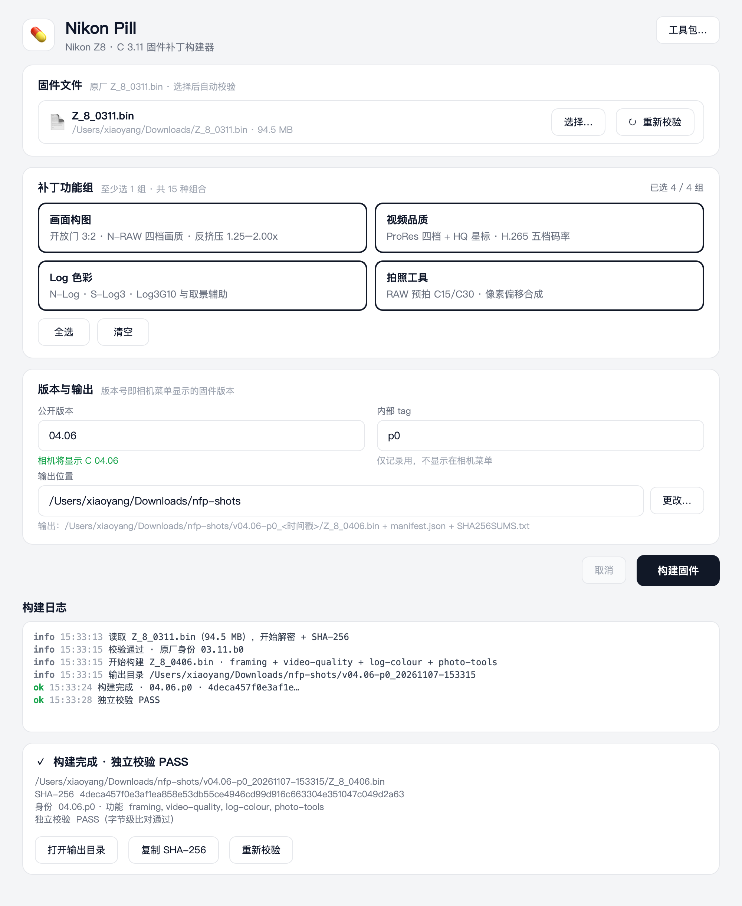
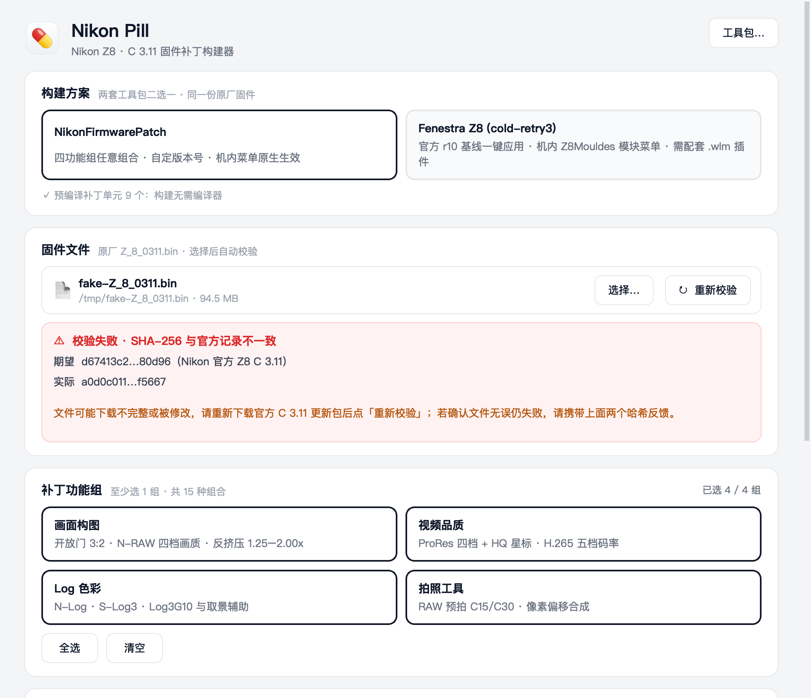

# 💊 Nikon Pill

**Nikon Z8 · C 3.11 固件补丁图形构建器** —— 一份原厂固件，两套补丁方案二选一：

| 方案 | 来源 | 特点 |
|---|---|---|
| **NikonFirmwarePatch** | [XinmiaoZhao/NikonFirmwarePatch](https://github.com/XinmiaoZhao/NikonFirmwarePatch) v0.4.0-rc.2 | 四功能组任意组合（15 种）、自定版本号（相机菜单显示）、构建含独立字节级校验 |
| **Fenestra Z8 (cold-retry3)** | [PIPA12344/Fenestra-Z8-C311-source](https://github.com/PIPA12344/Fenestra-Z8-C311-source) r10 | 官方基线一键应用（秒级），机内经 **Z8Mouldes** 模块菜单使用，功能经 `.wlm` 插件扩展 |

两套工具包在打包时**全部内置**（构建脚本自动从各自上游 Release/vendor），最终用户**无需安装 Python、无需编译器、无需下载任何工具**。



## ✨ 特性

- **校验前置** — 选择固件后自动解密并核对官方 SHA-256；不匹配时就地展开红色详情面板（期望/实际哈希 + 修复建议），阻止无效构建
- **功能组卡片** — 四组任选组合（共 15 种有效组合），点卡片即切换选中态
- **版本号即菜单版本** — 公开版本 `NN.NN` 直接写入相机菜单显示的固件版本，实时预览「相机将显示 C xx.xx」
- **时间戳输出** — 输出位置可选已存在的文件夹；每次构建自动创建 `v{版本}-{tag}_{时间戳}/` 子目录，永不覆盖历史产物
- **构建后自动独立校验** — 构建完成后自动执行字节级比对（PASS 才算成功），支持随时「重新校验」
- **结构化日志** — 等宽字体、级别着色（info/warn/err/ok），引擎输出的 JSON 噪音已过滤



## 📦 下载使用（最终用户）

| 平台 | 文件 | 安装 |
|---|---|---|
| macOS | `NikonPill-0.1.0-macOS.dmg` | 打开 → 拖入 Applications → 首次**右键 → 打开**（ad-hoc 签名，Gatekeeper 询问一次） |
| Windows | `NikonPill.exe` | 双击运行（SmartScreen 首次同样询问） |

应用内流程：

1. **构建方案** — 两张方案卡二选一（NFP 组合构建 / Fenestra 基线应用）
2. **固件文件** — 选择 Nikon 官方 `Z_8_0311.bin`（或直接拖入窗口），自动校验
3. **按方案分支**：
   - *NikonFirmwarePatch*：点功能组卡片组合（画面构图 / 视频品质 / Log 色彩 / 拍照工具），填公开版本（相机将显示）与内部 tag
   - *Fenestra*：功能与版本由 `cold-retry3.fxpatch` 决定，无需选择；产物 `Z_8_0311-cold-retry3.bin`
4. **输出位置** — 任意文件夹（可已存在）；NFP 自动建时间戳子目录，Fenestra 直接产出单文件
5. **构建固件** — 后台运行；NFP 用时 1–3 分钟，Fenestra 数秒。完成后自动校验：
   - NFP：独立字节级比对（PASS 才算成功），支持「重新校验」
   - Fenestra：结果 SHA-256 与官方 r10 基线（`0a9cdd07…`）比对，一致即 PASS

> 版本规则 `NN.NN`、tag `小写字母+数字`（仅 NFP 方案）；`00.xx` 为上游保留，实机请避开。
> 不同功能组合建议用不同版本身份，便于机内区分。Fenestra 产物刷入后，将 Release 里的
> `FENESTRA/` 文件夹（含 .wlm 插件）放到存储卡根目录即可在机内 Z8Mouldes 菜单使用。

## 🔧 从源码运行（开发者）

要求：Python ≥ 3.10（本机无需 clang——内置工具包走预编译模式）。

```sh
git clone https://github.com/xyl-g/Nikon-Pill.git
cd Nikon-Pill
python3 -m venv .venv && .venv/bin/pip install PySide6 capstone==5.0.7   # Windows: py -m venv .venv
./.venv/bin/python backend.py --toolkit ~/git/NikonFirmwarePatch-toolkit-v0.4.0-rc.2   # 自测
./.venv/bin/python main.py                                             # 启动 GUI
```

源码态没有内置工具包，界面上会出现「工具包…」按钮，指向任一 NFP 工具包目录：

| 工具来源 | 获取方式 | 构建模式 |
|---|---|---|
| **完整 Release 工具包**（推荐） | 从 [NFP Releases](https://github.com/XinmiaoZhao/NikonFirmwarePatch/releases/tag/v0.4.0-rc.2) 下载 `NikonFirmwarePatch-v0.4.0-rc.2-toolkit.zip`，按其 `SHA256SUMS.txt` 核对后解压 | 预编译（无需编译器） |
| Git 克隆 | `git clone https://github.com/XinmiaoZhao/NikonFirmwarePatch` | 源码编译（**需要 clang**，且编译器版本须与上游审阅配方一致——上游锁定 Apple clang 21.0.0 字节；CLT 自动升级会导致 `Compiled symbols differ` 失败） |

官方原厂固件 `Z_8_0311.bin` 须自行从 Nikon 下载（SHA-256 `d67413c2ede6b9ce8887175f20700bd9fbad2a973a4820968c45503d15d80d96`），见 [NFP README 的下载指引](https://github.com/XinmiaoZhao/NikonFirmwarePatch#获取原厂固件)。

## 🛠 打包 DMG / EXE

构建脚本会**自动 vendor 工具包**（首次运行时从 GitHub Release 下载并做 SHA-256 校验，存入 `vendor/`；也可用环境变量 `NFP_VENDOR_DIR` 指向已解压目录），自动生成 💊 图标，再调用 PyInstaller：

```sh
# macOS → dist/Nikon Pill.app + dist/NikonPill-0.1.0-macOS.dmg
zsh build-macos.sh

# Windows → dist/NikonPill.exe（one-file，无控制台窗口）
build-windows.bat
```

或直接用 GitHub Actions：`.github/workflows/build.yml`（push / 手动触发，双平台 artifact）。

### 打包原理

- PyInstaller（`console=False`）打包 GUI；完整工具包作为数据放入 `nfp/`；
- 引擎不单独打包：冻结应用**重入自身**（`main.py --nfp-engine-patch …`），以 `runpy` 执行内置 `nfp/patch.py`（multiprocessing 自启动同款模式）——最终用户无需 Python 与编译器；
- Windows 子进程取消用 `taskkill /T /F`（杀整棵进程树）+ `CREATE_NO_WINDOW`；
- 图标由 `make_icon.py` 现场渲染 💊（macOS 用 Apple Color Emoji，Windows 用 Segoe UI Emoji）。

## 🧾 与上游的关系

- UI 通过 **subprocess** 调用上游 `patch.py` / `verify.py`，不 import、不修改 NikonFirmwarePatch 的任何文件；
- 固件补丁的全部功劳属于 [NFP 上游](https://github.com/XinmiaoZhao/NikonFirmwarePatch)（四功能组：开放门 N-RAW、ProRes/H.265 品质、三 Log 色彩、RAW 预拍与像素偏移）；
- 刷机请将输出 `.bin` 放入存储卡根目录，按尼康官方固件更新流程操作；**本工具只做离线构建，不与相机通信，实验固件风险自担**。

## 许可

遵循上游 NikonFirmwarePatch 的许可条款；Nikon、Z8 为 Nikon Corporation 的商标，本项目与 Nikon 官方无关。
